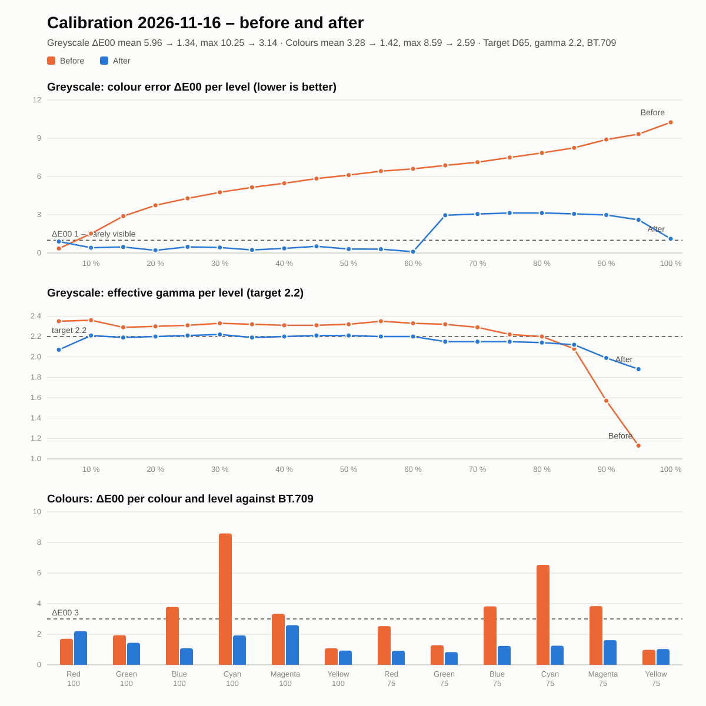
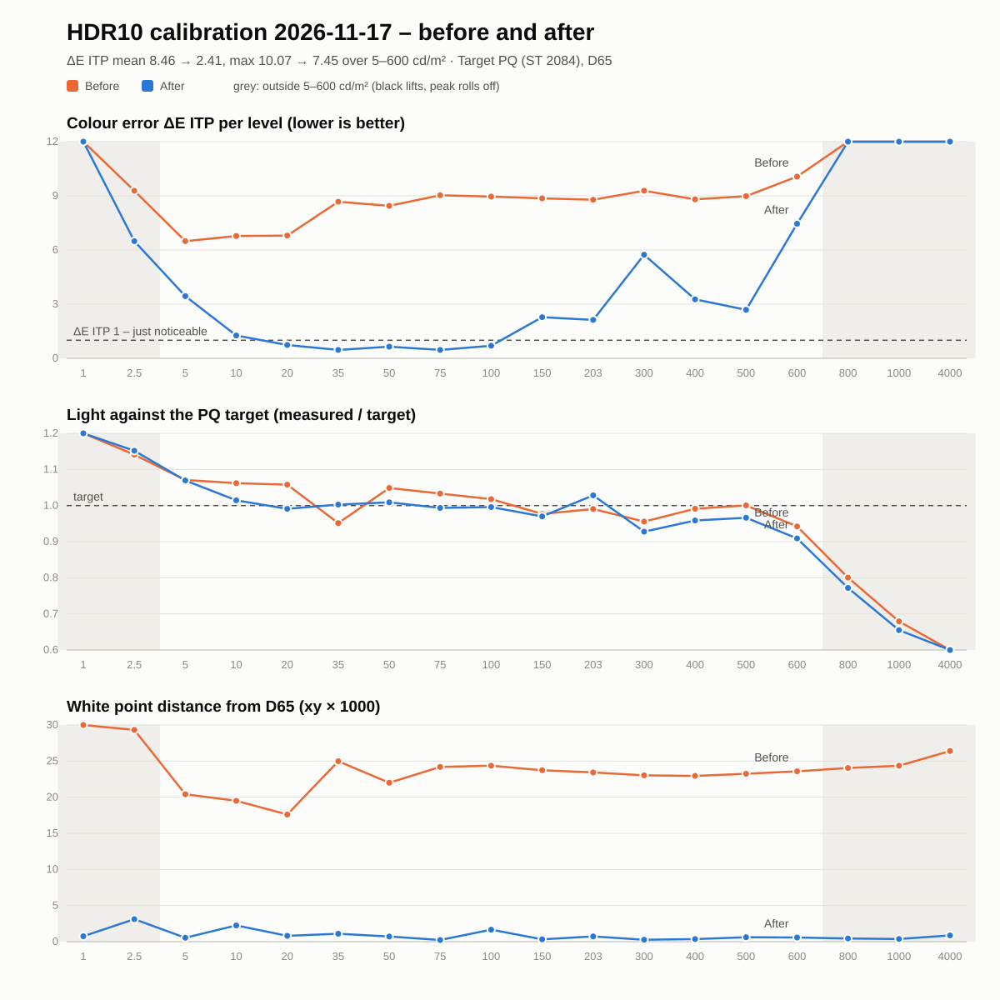

# tv-cal-studio

Open source auto-calibration for a Xiaomi Google TV. It measures with an X-Rite i1Display Pro, shows
test patterns from a small app on the TV, and writes the picture settings straight into the TV's
MediaTek picture database – no service menu and no Calman licence needed.



## The TV

| | |
|---|---|
| Model | Xiaomi `MiTV-MOEU0` (codename `ladybird`), Google TV / Android 14 |
| Panel | QD-Mini LED, 3840×2160 @ 60 Hz |
| SoC | MediaTek MT9689 – settings live in MediaTek's `settingspqdb` database |
| Picture mode | `Movie` (SDR) and `ImaxEnhanced` (HDR10), built-in apps |

Other TVs with a MediaTek SoC may expose the same database, but only this model has been tested.
HDR10 has its own settings on this TV and is calibrated separately (`tvcal hdr10`). HLG, Dolby Vision
and HDMI sources are not calibrated yet.

## How it works

The TV's own picture processing only applies to the video plane, so patterns are played as video by
an app on the TV (`spikes/pqprobe`). The same app has the (normal-level) permissions to read and write
`settingspqdb`, and only accepts the keys and ranges in its allow-list. The computer drives it over
`adb`, reads every write back, and runs the chain:

local dimming off → backlight → white point (2-point gain) → backlight → gamma preset →
multi-point white balance → colour management → measurement

A snapshot of every writable key is taken first, and the TV is restored afterwards – also on errors
and Ctrl+C – unless `--keep` is given.

## Target

BT.709, D65 white point, gamma 2.2 and 200 cd/m² white, with local dimming off.
Result on 2026-11-16: greyscale mean ΔE2000 5.96 → 1.34 (max 10.25 → 3.14); colours 3.28 → 1.42.

HDR10: PQ (ST 2084) in absolute luminance and D65, with local dimming off. HEVC Main10 patterns make
the TV switch to HDR10, where it tracks PQ within about ±4 % up to 600 cd/m² and rolls off towards
about 740 cd/m². The app refuses to read or write unless the TV is in HDR10, so the SDR calibration is
never touched. Result on 2026-11-17 (white point and multi-point white balance): greyscale mean
ΔE ITP 8.46 → 2.41 over 5–600 cd/m².



## Requirements

- X-Rite i1Display Pro and [ArgyllCMS](https://www.argyllcms.com/) (`spotread`)
- `adb`, and the TV on the same network with network debugging (ADB over TCP) enabled
- The pattern app on the TV, built and installed with `spikes/pqprobe/build.sh` (JDK + Android SDK, no Gradle)
- Python 3.14, standard library only
- `ffmpeg` for the pattern videos

`scripts/install_arch.sh` installs the tools on Arch Linux and `scripts/check_hardware.sh <tv-ip>`
checks that everything is found. Everything runs locally; no internet connection is needed.

## Quick start

```bash
export TVCAL_TV=192.168.1.50                 # the TV's address (or pass --tv every time)
python3 -m tvcal.cli check                   # tools, meter, TV and current settings
python3 -m tvcal.cli measure --colors        # measure greyscale and colours, writes nothing
python3 -m tvcal.cli calibrate all --keep    # full chain, keep the result
python3 -m tvcal.cli restore data/runs/<run>/snapshot.json   # back to before
python3 -m unittest discover -s tests -t .   # tests against a simulated TV, no hardware
```

Without `--keep` the TV is restored after the run. Reports and snapshots go to `data/runs/`.

## Documentation

The detailed docs are in Swedish:

- [`docs/TVCAL.md`](docs/TVCAL.md) – the program, the calibration steps and safety
- [`docs/HARDWARE.md`](docs/HARDWARE.md) – probing the TV and what each setting actually does, with measurements

## Colorimeter correction

`ccss/qd-miniled-tcl-50c7k.ccss` is a spectral correction for QD-Mini LED panels, measured with a
JETI spectraval on a TCL 50C7K and taken from the DisplayCAL colorimeter corrections database. It is
not measured on this panel; see `docs/HARDWARE.md` for how it was chosen.

## Disclaimer

This writes to undocumented settings on your TV. It has only been tested on one model and firmware
(`V816.0.25.12.1.ULBMIXM`). Use at your own risk.

## Licence

[MIT](LICENSE)
