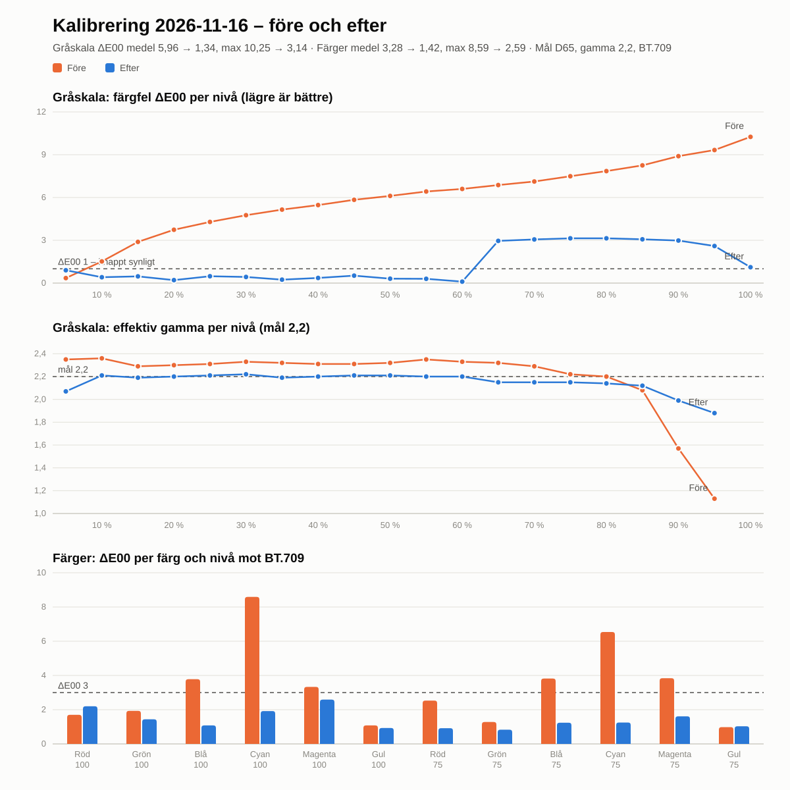

# Hårdvara och sondering

Fynd från läs-sonderingen 2026-11-14 (`scripts/detect_tv.sh` plus manuell granskning av två
systemappar) och skrivproven 2026-11-15. Till TV:n har skrivits `Backlight`, `Color_Temperature`
vitbalansens gain (aktiv 512–2047 och Warm-förinställning), offset, `Gamma` och flerpunkts
vitbalansen, allt återställt till ursprungsvärdena. Varje punkt är märkt **verifierat** (uppmätt eller avläst)
eller **overifierat** (slutsats från namn i kod, inte provad).

## TV

| | |
|---|---|
| Modell | Xiaomi `MiTV-MOEU0`, kodnamn `ladybird` |
| Android | 14 (SDK 34), firmware `V816.0.25.12.1.ULBMIXM`, build-typ `user` |
| SoC | MediaTek MT9689 (`ro.hardware=mt5896`), `armeabi-v7a` – 32-bitars appar |
| Panel | 3840×2160 @ 60 Hz, gränssnittet ritas i 1920×1080 |
| ADB | TCP 5555, skalet kör som `uid=2000 (shell)`, ingen root |

Allt i tabellen är verifierat.

## HDR och färg i Android-kedjan

- **Verifierat:** skärmen anmäler HDR-typerna 1–4 (Dolby Vision, HDR10, HLG, HDR10+).
- **Verifierat:** `supportedColorModes [0]` – gränssnittslagret har bara ett färgläge. En vanlig
  vy kan alltså inte begära brett färgomfång eller HDR.
- **Verifierat:** `mMaxLuminance=100.0` i `HdrCapabilities` är ett platshållarvärde. TV:ns egna
  ljusuppgifter får inte användas som referens.
- **Verifierat (2026-11-17):** HDR10-mönster via videoavkodning (HEVC Main10, PQ, BT.2020) når
  panelen och följer PQ-kurvan upp till tonmappningen. Se "HDR10 från provappen" nedan.

### HDR10 från provappen 2026-11-17
Mönster från `scripts/make_pattern_hdr.sh` (HEVC Main10, 10-bitarskoder i begränsat omfång ritade
direkt i YUV, P3/D65-metadata 1000/0,0001 cd/m², max-cll 1000,400), spelade i provappens vanliga
`VideoView`. Mätt med `scripts/hdr_check.py`, CCSS `qd-miniled-tcl-50c7k`, ruta 10 %.
Körning `data/runs/2026-11-17_123733_hdr10/`.

- **TV:n byter läge:** `/hdr` svarar `HDR10` medan mönstret visas, `DispLink` loggar `Hdr 1`,
  och bildläget blir `ImaxEnhanced`. Ingen `SurfaceView` eller `KEY_HDR_STATIC_INFO` behövs.
- **Egna värden per HDR-typ:** i HDR10-läget står vitbalans, flerpunkts vitbalans och
  färghantering på fabriksvärden (Warm 1036/1024/976, `PQ_WB_11_Point_enabled=Off`,
  `COLORTUNER_SWITCH=Off`), `Backlight=100`, `Gamma_Mode=ST2084`, `TMO_Range=LevelPriority`,
  `Global_Dimming=Off`, `LD_MODE=Off`. SDR-kalibreringen syns inte där, och en skrivning medan
  HDR10 visas ändrar inte SDR. Nycklarna före och efter: `data/probe/2026-11-17/pqdb_general_{sdr,hdr10}.txt`.
  Fabrikens förinställningar (`/vendor/etc/pq/presetdb_test/*.json`) ligger i `data/probe/2026-11-17/vendor_pq/`.
- **PQ-kurvan** (mätt / kodens luminans):

  | cd/m² | 1 | 5 | 10 | 20 | 50 | 100 | 203 | 400 | 600 | 700 | 800 | 1000 | 2000 | 4000 |
  |---|---|---|---|---|---|---|---|---|---|---|---|---|---|---|
  | mätt | 1,44 | 4,95 | 9,21 | 20,0 | 50,7 | 99,1 | 199,6 | 403 | 580 | 627 | 657 | 696 | 740 | 739 |
  | kvot | 1,45 | 0,99 | 0,92 | 1,00 | 1,01 | 0,99 | 0,98 | 1,00 | 0,97 | 0,89 | 0,82 | 0,69 | 0,37 | 0,18 |

  Kurvan följer PQ inom cirka ±4 % (10 cd/m² −8 %) från 5 till 600 cd/m² och avrundas sedan mot
  cirka 740 cd/m². Svart är cirka 0,4 cd/m² (`Backlight=100`, lokaldämpningen av), så 1 cd/m²
  ligger högt. Vitpunkten ligger blått över hela skalan: x 0,299–0,301, y 0,310–0,312 (D65
  0,3127/0,3290).
- **Yta och lokaldämpning** (1000 cd/m² i signalen): med `LD_MODE=Off` 688–690 cd/m² på 2, 10 och
  25 % av ytan. Med `High` 308 (2 %), 684 (10 %) och 874 (25 %) – och 100 cd/m² blir 58 på 2 %.
  Lokaldämpningen gör alltså ljuset beroende av ytan åt båda hållen; kalibrering görs utan den.
- **Primärerna** (P3 inom BT.2020, andelar av vitt 100 cd/m²): röd 0,653/0,305 (P3 0,680/0,320),
  grön 0,270/0,664 (0,265/0,690), blå 0,156/0,049 (0,150/0,060). Klart bredare än BT.709 – TV:n
  tolkar signalen som BT.2020. Rött når inte P3 (panelens röda ligger åt orange, som i SDR).
- **Metadata:** max-cll 1000, 4000 eller ingen metadata ger samma resultat (100 → 100,8–101,0;
  1000 → 687–689). Tonmappningen är fast och följer inte strömmens metadata.

## Bildinställningar

### Androids inställningstabell (verifierat, läsning)
`settings list global` innehåller `picture_mode=4`, `picture_backlight=49`, `picture_gamma=0`.
Skalet har rätt att skriva i tabellen, men det är **overifierat** om TV:n reagerar på en skrivning.

### MediaTeks bilddatabas `settingspqdb`
- **Verifierat:** leverantören `com.mediatek.tv.settingspqdb` ägs av `com.mediatek.tv.agent`
  (`.settingspqdb.PqProvider`).
- **Verifierat:** ADB-skalet nekas (`requires ...settingspqdb.permission.READ_DATA or WRITE_DATA`).
- **Verifierat:** båda behörigheterna har skyddsnivå `normal`, alltså sådana som en vanlig
  installerad app får genom att deklarera dem i sitt manifest.
- **Verifierat (namn i koden):** tabellen `pq` har kolumnerna `Source`, `PictureMode`, `HdrType`
  – värden lagras per ingång × bildläge × HDR-typ. Sökvägar som förekommer: `/general`, `/source`,
  `/stream`, `/stream_by_source`, `/hdr`, `/reset`, `/reset_by_item`, `/calman_mode`,
  samt fabrikstabeller (`/general_factory`, `/gamma_table_factory`, `/rgbw_coordinate_factory`).
- **Verifierat (namn i koden):** 2-punkts vitbalans per färgtemperatur
  (`Color_Temperature_<läge>_<Red|Green|Blue>_<Gain|Offset>`) och färghantering för R, G, B, C, M,
  Y och hudton (`CFG_FUSION_PIC_COLOR_TUNER_{HUE,SAT,BRI}_*`, samt `GAIN_*`/`OFFSET_*` för RGB).
- **Verifierat (läst med `spikes/pqprobe`):** en egen app med `READ_DATA` får behörigheten vid
  installation och kan läsa databasen. `/source` gav `mm` (inbyggda appar), `/hdr` gav `SDR`.
- **Verifierat:** `/general` läses med nyckelnamnet som projektion och svarar bara på det första
  namnet – en fråga per nyckel. Värdena gäller aktuell ingång och aktuellt bildläge.
- **Verifierat (lästa värden, bildläge `Movie`):**
  - Grund: `Backlight=30`, `Brightness=50`, `Contrast=50`, `Saturation=50`, `Hue=0`,
    `Gamma=Gamma22`, `Color_Temperature=Warm`, `Color_space=Auto`.
  - 2-punkts vitbalans: `Color_Temperature_{Red,Green,Blue}_Gain=1024` (aktiva värden) och
    förinställningen `Color_Temperature_Warm_*_Gain` = 1036/1024/976. Offset-nycklarna är tomma.
  - Flerpunkts vitbalans: `PQ_WB_11_Point_<0–11>_{Red,Green,Blue}`, alla 50, med
    `PQ_WB_11_Point_enabled=Off`. Tolv index trots namnet "11 Point".
  - Färghantering: `COLORTUNER_{H,S,Y}_{R,G,B,C,M,Y,F}` och `COLORTUNER_{R,G,B}_{GAIN,OFFSET}`,
    alla 50, med `COLORTUNER_SWITCH=Off`.
  - Mini-LED och dynamik: `LD_MODE=High`, `Global_Dimming=On`, `Local_Contrast=Middle`,
    `DLC_STRENGTH=Off`, `Peak_Bright=Off`, `HDR_Mode=Auto`, `TMO_Range=Off`, `Calman_Mode=Off`.
  - Fullständig lista: kör provappen, resultatet hamnar i `data/probe/<datum>/pqdb_general.txt`.
- **Verifierat (namn i koden):** en skrivning är `update` mot `/general` med nyckelnamnet som
  kolumn och värdet som sträng. Leverantören behandlar bara första nyckeln i anropet, svarar `1`
  direkt och lagrar värdet på en egen tråd.
- **Verifierat (skrivprov 2026-11-15, se nedan):** en egen app med `WRITE_DATA` får skriva, och
  en skrivning av `Backlight` ändrar ljuset direkt och går att ta tillbaka.
- **Verifierat:** `settings`-tabellens `picture_backlight=49` ändras inte när databasens
  `Backlight` skrivs. Databasen är den som når panelen; vad `picture_backlight` gör är oklart.
- **Verifierat:** vitbalans och färgtemperatur verkar bara på videoplanet. Se
  "Skrivprov vitbalans" nedan.
- **Overifierat:** värdeintervall för gain och övriga nycklar.

#### Skrivprov bakgrundsljus 2026-11-15
Helvit bild från provappens `PatternActivity`, bildläge `Movie`, SDR, `LD_MODE=High`,
`Global_Dimming=On`. Mätt med i1Display Pro och `spotread -e -x -O`, två avläsningar per steg.

| Steg | `Backlight` läst tillbaka | Luminans (cd/m²) | x, y |
|---|---|---|---|
| Före | 30 | 344,3 / 344,3 | 0,2983 / 0,3037 |
| Skrev 29 | 29 | 347,6 / 347,6 | 0,2982 / 0,3036 |
| Skrev 30 | 30 | 344,2 / 344,1 | 0,2983 / 0,3037 |

Svart bild gav 0 cd/m². Tre avläsningar på vitt före provet drev högst 0,25 cd/m², så steget på
3,3 cd/m² (knappt 1 %) kommer från skrivningen.

Värdet 29 gav *högre* luminans än 30. Svepet nedan visar att det är ett ojämnt steg just där,
inte en omvänd skala.

#### Svep bakgrundsljus 2026-11-15
Samma läge som skrivprovet. Vit ruta på 10 % av ytan mot svart respektive helvit bild
(`PatternActivity --ei window 10`), medel av två avläsningar per steg. Läst värde stämde med
skrivet i varje steg utom det sista (se nedan). Rådata i `data/probe/2026-11-15/backlight_sweep_*.csv`.

| `Backlight` | Fönster 10 % (cd/m²) | Helvit (cd/m²) |
|---|---|---|
| 0 | 157,2 | 151,2 |
| 10 | 225,2 | 222,8 |
| 20 | 297,8 | 287,5 |
| 25 | 324,2 | 325,0 |
| 28 | 347,3 | 340,9 |
| 29 | 347,0 | 349,9 |
| 30 | 357,6 | 346,8 |
| 31 | 364,3 | 355,6 |
| 32 | 369,0 | 367,4 |
| 35 | 388,9 | 382,2 |
| 40 | 419,4 | 420,4 |
| 50 | 481,2 | 484,9 |
| 75 | 622,1 | 635,5 |
| 100 | 754,5 | 784,7 |

- **Verifierat:** intervallet 0–100 tas emot, och skalan går åt rätt håll och är ungefär rak:
  cirka 6 cd/m² per steg. Värdet 0 släcker inte panelen (drygt 150 cd/m² på vitt).
- **Verifierat:** stegen är ojämna kring 28–30. På helvit bild ligger 29 över 30 (349,9 mot 346,8,
  samma ordning som i skrivprovet), på fönstret ligger 28 och 29 lika. Enskilda steg kan alltså
  inte användas för finjustering utan att mäta.
- **Verifierat:** helvit bild begränsas inte – vid 100 är den ljusare än fönstret.
- **Verifierat:** vitpunkten flyttar sig med bakgrundsljuset, x från 0,298 vid 0 till 0,290 vid
  100 på fönstret (y nästan oförändrat). Vitbalansen måste ställas vid det bakgrundsljus som ska gälla.
- **Verifierat:** `picture_backlight` låg kvar på 49 genom hela svepet.
- Upprepade mätningar av 30 på fönstret gav 358,6, 357,6 och 354,5 – drift på omkring 1 % under
  svepet, störst efter stegen på 75 och 100.
- **Oklart:** sista steget i helskärmssvepet (100 → 30) gick inte igenom; läst värde var kvar på
  100 och luminansen 774 cd/m². adb-anslutningen bröts kort i steget före, och svepskriptet
  kontrollerade inte att anropet nådde fram. En ny skrivning av 30 direkt efteråt gick igenom
  (342 cd/m² uppmätt). Det styrande programmet måste läsa tillbaka varje skrivning.

#### Skrivprov vitbalans 2026-11-15
Bildläge `Movie`, SDR, `Backlight=30`. Mätt som ovan med `scripts/pq_sweep.sh`.
Rådata i `data/probe/2026-11-15/Color_Temperature*.csv`.

**Grafikplanet tas inte med.** Med provappens vanliga vy (vit ruta 10 %) ändrade varken blå gain
(974–1074) eller lägesbyte Warm → Standard → Cool något utöver driften. Skrivningarna gick igenom:
`logcat` visar att hela inställningssträngen når bild-HAL:en (`PQ_AIDL`, `onNotifyPqSettingInfo`)
med de nya värdena. Xiaomis filter verkställer bakgrundsljuset ("set backlight 30 by app"), och
`MI_RENDER_GRAPHIC_ParseGain` misslyckas (`RET: 18`). Bakgrundsljuset gäller hela panelen och syns
därför på allt.

**Videoplanet tas med.** Samma vita ruta som H.264-video (`PatternActivity --es video`):

| Skrivning | Y (cd/m²) | x | y |
|---|---|---|---|
| `Color_Temperature=Warm` | 349,3 | 0,3025 | 0,3121 |
| `Color_Temperature=Standard` | 317,9 | 0,2786 | 0,2878 |
| `Color_Temperature=Cool` | 283,3 | 0,2672 | 0,2728 |
| `Color_Temperature_Blue_Gain=1024` | 354,2 | 0,2944 | 0,3000 |
| `Color_Temperature_Blue_Gain=974` | 347,5 | 0,3029 | 0,3125 |
| `Color_Temperature_Blue_Gain=1074` | 353,8 | 0,2943 | 0,3000 |
| `Color_Temperature_Warm_Blue_Gain=926` + omladdning Cool → Warm | 344,0 | 0,3107 | 0,3257 |
| `Color_Temperature_Warm_Blue_Gain=976` + omladdning Cool → Warm | 347,5 | 0,3025 | 0,3119 |

Vad HAL:en fick, avläst i `logcat` efter varje skrivning:

- **Verifierat:** förinställningen `Color_Temperature_<läge>_<färg>_Gain` lagras utan att något
  skickas till HAL:en. Den verkställs när läget laddas, alltså vid byte till läget. Förinställningarna
  för Warm är 1036/1024/976, för Cool 855/919/1060.
- **Verifierat:** den aktiva nyckeln `Color_Temperature_<färg>_Gain` skickas direkt och ersätter
  den kanalen i HAL:en tills läget laddas om. Databasens värde visar därför inte vad panelen har:
  den står på 1024 också när HAL:en kör förinställningens 976.
- **Verifierat:** gain 1074 gav samma resultat som 1024 på vitt trots att HAL:en fick 1074. Se
  "Gain-intervall" nedan.
- **Verifierat:** grafikplanets vita (0,2945/0,3005) ligger nära video med gain 1024 på alla
  kanaler, inte nära Warm. Gränssnittet går alltså förbi färgtemperaturen.
- Följd för projektet: mönster för vitbalans, gamma och färg måste visas som video. Svepet av
  bakgrundsljuset ovan gjordes i grafikplanet; luminansstegen gäller ungefär, men vitpunkterna där är
  grafikplanets och inte det som video och appar visar.
- Följd för det styrande programmet: att ställa vitbalansen via förinställningen och ladda om läget
  ger ett tillstånd som går att läsa tillbaka ur databasen. Den aktiva nyckeln gör inte det.

#### Gain-intervall 2026-11-15
Aktiv gain per kanal, mätt på video med en ruta på 10 % i kanalens egen färg (BT.709, 100 %)
och på vitt. Övriga kanaler på Warm-förinställningen, `Backlight=30`. Värdet är luminansen
relativt gain 1024 på samma ruta. Rådata i `data/probe/2026-11-15/Color_Temperature_*_Gain_*.csv`.

| Gain | Röd ruta | Grön ruta | Blå ruta |
|---|---|---|---|
| 512 | 0,281 | 0,232 | 0,155 |
| 640 | | | 0,269 |
| 768 | 0,549 | 0,514 | 0,431 |
| 896 | | | 0,647 |
| 976 | 0,895 | 0,920 | 0,848 |
| 1024 | 1 (71,2 cd/m²) | 1 (257,4 cd/m²) | 1 (32,2 cd/m²) |
| 1040 | | | 1,067 |
| 1060 | 1,077 | 1,006 | 1,093 |
| 1100 | 1,144 | 1,006 | 1,091 |
| 1200–2047 | | | 1,091 |

- **Verifierat:** spärren tog emot 512–2047 och HAL:en fick värdet oförändrat. Referensen 1024
  mättes före, mitt i och efter varje svep och drev under 0,5 %.
- **Verifierat:** gain verkar inte rakt på ljuset. 512 ger 15–28 % av ljuset, inte 50 %, och
  kurvan skiljer sig mellan kanalerna. Gain verkar alltså på signalen före gammakurvan, och
  sambandet måste mätas. Rutans färgpunkt flyttar sig också med gain (röd ruta x 0,632 → 0,560 vid
  512), så rutorna mäter inte en ren kanal.
- **Verifierat:** på vitt ger gain över 1024 inget för grönt och blått, och rött slutar vid 1036
  (1036, 1060 och 1100 mätte lika, x 0,3023 mot 0,3018 vid 1024). Warm-förinställningens röda 1036
  ligger alltså vid taket. På enfärgade rutor finns mer utrymme (blått till cirka 1060, rött över
  1100), troligen för att BT.709-färgerna räknas om till panelens bredare omfång och inte styr
  kanalen fullt. Den förklaringen är overifierad.
- Följd för vitbalansen: i praktiken ställs den genom att sänka kanaler från 1024 (rött 1036).
  Uppåt finns inget att hämta på vitt, nedåt räcker intervallet gott.

#### Offset 2026-11-15
- **Verifierat:** offset går inte att styra via databasen. De aktiva nycklarna
  `Color_Temperature_<färg>_Offset` och förinställningens `Color_Temperature_Warm_<färg>_Offset` är
  tomma från början. Skrivna värden (974–1074) lagras, och HAL:en får en ny inställningssträng,
  men offset i strängen står kvar på 1024 för alla kanaler, också efter omladdning av läget.
- **Verifierat:** blå offset 974–1074 på 10 % grått (video) gav ingen skillnad i luminans eller
  färgpunkt (1,619–1,622 cd/m², x/y inom 0,0002).
- Den mörka änden justeras i stället med flerpunkts vitbalansen, se nedan.

#### Gamma 2026-11-15
`Gamma` sveptes på video med grå rutor (10 % av ytan) på sex nivåer. Värdet inom parentes är
effektiv gamma, log(Y/Y_vit)/log(nivå), där nivån är rutans RGB-värde före BT.709-kodning.
Rådata i `data/probe/2026-11-15/Gamma_*.csv`, mönstren gjorda med `scripts/make_pattern.sh`.

| Nivå | Gamma18 | Gamma20 | Gamma22 | Gamma24 | Gamma26 |
|---|---|---|---|---|---|
| 100 % (cd/m²) | 354,5 | 354,1 | 353,8 | 353,9 | 353,6 |
| 80 % | 239,9 (1,75) | 226,1 (2,01) | 214,9 (2,23) | 205,9 (2,43) | 193,0 (2,71) |
| 50 % | 95,6 (1,90) | 82,5 (2,11) | 70,5 (2,34) | 60,6 (2,56) | 53,0 (2,75) |
| 20 % | 16,8 (1,89) | 12,0 (2,10) | 8,57 (2,31) | 6,13 (2,52) | 4,41 (2,72) |
| 10 % | 4,51 (1,91) | 2,81 (2,12) | 1,62 (2,36) | 0,98 (2,58) | 0,60 (2,79) |
| 5 % | 1,149 (1,92) | 0,595 (2,15) | 0,323 (2,35) | 0 | 0 |

- **Verifierat:** `Gamma` slår igenom direkt på video, och varje steg flyttar effektiv gamma med
  cirka 0,2. Vitt påverkas inte. Referensen Gamma22 mätt före och efter varje svep skilde under 1 %.
- **Verifierat:** under 80 % ligger kurvorna 0,1–0,2 över sitt namn (Gamma22 ger 2,31–2,36).
  Vid 80 % ligger de närmare namnet eller under.
- **Verifierat:** med Gamma24 och Gamma26 blir 5 % grått helt svart (0,000 cd/m² mot väntat
  cirka 0,2–0,3). Med lägre gamma syns nivån. Overifierat om det är lokaldämpningen
  (`LD_MODE=High`) som släcker.
- **Verifierat:** `BT1886` lagras i databasen men når aldrig HAL:en, som behåller föregående
  gamma. Värdet är borttaget ur provappens spärr.
- **Overifierat:** vad `Gamma_Mode` gör. Den stod kvar på `Gamma22` i HAL-strängen när `Gamma`
  ändrades.

#### Flerpunkts vitbalans 2026-11-15
Nycklarna `PQ_WB_11_Point_<0–11>_{Red,Green,Blue}` (0–100, 50 neutralt) och
`PQ_WB_11_Point_enabled` (`On`/`Off`). Mätt på video med grå rutor (10 % av ytan) med
`scripts/pq_levels.sh`, som mäter en rad nivåer före och efter en uppsättning skrivningar.
Rådata i `data/probe/2026-11-15/levels_*.csv` och `PQ_WB_11_Point_5_Blue_*.csv`.

- **Verifierat:** med `enabled=Off` når punktskrivningar inte HAL:en. Med `On` skickas de direkt
  och slår igenom utan omladdning.
- **Verifierat:** punkt *i* styr grånivån 5 % × (*i* + 1), alltså 5, 10, 15 … 60 %. Sju punkter
  provades (0, 2, 3, 5, 8, 10, 11) mot förutsägelsen, med olika kanaler så att riktningen visade
  vilken punkt som träffade. Effekten är lokal: den egna nivån flyttas mycket, nivån 5 % under
  lite (till exempel 10 % med x/y +0,002/+0,004 när punkten för 15 % ändrades), nivån över inte alls.
- **Verifierat:** nivåerna 65–100 % påverkas inte av någon punkt. Där gäller bara 2-punkts gain.
- **Verifierat:** skalan är jämn och verkar åt båda hållen. Blå punkt 5 på 30 % grått:

| Värde | Y (cd/m²) | x | y |
|---|---|---|---|
| 0 | 20,91 | 0,3521 | 0,3944 |
| 20 | 21,17 | 0,3332 | 0,3610 |
| 40 | 21,50 | 0,3152 | 0,3294 |
| 50 | 21,70 | 0,3065 | 0,3149 |
| 60 | 21,94 | 0,2984 | 0,3010 |
| 80 | 22,48 | 0,2832 | 0,2740 |
| 100 | 23,21 | 0,2692 | 0,2495 |

  Ungefär 0,0008–0,0009 i x och 0,0013–0,0016 i y per steg, utan tak. 50 → 0 → 50 gav samma
  värde tillbaka.
- **Overifierat:** om skalan är densamma för röd och grön och på andra nivåer, och vad
  `PQ_WB_11_Point_gain` (läst 0) gör.
- Följd för det styrande programmet: gråskalan justeras i två lager – 2-punkts gain sätter vitt
  och den övre delen, flerpunkts vitbalansen nivåerna 5–60 %. Ovanför 60 % finns ingen egen punkt,
  så 65–95 % får följa gain och gamma.

#### Första hela gråskalekalibreringen 2026-11-15
`tvcal calibrate all --target-y 200`, återställd efteråt. Rapporter i
`data/runs/2026-11-15_232916/`.

| | Före | Efter |
|---|---|---|
| ΔE00 medel / max (5–100 %) | 4,51 / 8,00 | 1,50 / 3,47 |
| Vitt | 353 cd/m², x/y 0,3025/0,3125 | 203 cd/m², 0,3124/0,3297 |
| Effektiv gamma 10–60 % | 2,30–2,37 | 2,18–2,24 |

Stegen gav `Backlight=8`, Warm-gain 1009/1024/913 och `Gamma22`, och flerpunkts vitbalansen
hamnade på 56–71 per kanal (ΔE00 0,2–1,0 per punkt).

- **Verifierat:** 65–95 % ligger cirka +0,004 i y över vitt, både före och efter. Ingen punkt
  når dit, så felet ligger kvar (ΔE00 2,9–3,5). `--white-compromise` (standard) lägger därför
  vitt halvvägs mot 80 %-tonen.
- **Verifierat:** 65–75 % blir 3–4 % för mörka och 85–95 % 3–7 % för ljusa. Gammaförvalet
  kan inte rätta det.
- **Verifierat:** vid `Backlight=8` blir 5 % helt svart (0,000 cd/m² mot målet 0,29), som vid
  Gamma24/26 med `Backlight=30`. Zonen tycks släckas under cirka 0,2–0,3 cd/m², troligen av
  lokaldämpningen (`LD_MODE=High`). Flerpunkts vitbalansen kan inte rätta det: utan ljus finns
  inget att justera, och ΔE00 blir litet (0,7) fast nivån saknas helt.

### Färgomfång 2026-11-16
Rutor på 10 % (video) i R, G, B, C, M, Y och vitt, före och efter en skrivning
(`scripts/pq_levels.sh`). Rådata i `data/probe/2026-11-16/levels_*.csv`.

- **Verifierat:** `Gamut_Mapping` står på `Disable` (värdena är `Enable`/`Disable`). `Enable`
  ändrade inget.
- **Verifierat:** `Color_space=Auto` ger samma som `BT709`. `DCI` breddar omfånget tydligt
  (grönt y +0,071, rött x +0,028). `Native` ändrade inget och är troligen inget giltigt värde.
- **Verifierat:** `COLORTUNER_SWITCH=On` med alla värden på 50 ändrar inget.
- Färgerna i `Auto` (bildläge Movie, okalibrerat Warm), mot BT.709 och gamma 2,2:

| Färg | Y mot mål | x, y | Mål x, y |
|---|---|---|---|
| Röd | −2,4 % | 0,6335, 0,3438 | 0,6401, 0,3300 |
| Grön | +4,5 % | 0,3141, 0,5885 | 0,3000, 0,6000 |
| Blå | +8,8 % | 0,1561, 0,0555 | 0,1500, 0,0600 |
| Cyan | +4,9 % | 0,2298, 0,3057 | 0,2247, 0,3287 |
| Magenta | −2,2 % | 0,2985, 0,1400 | 0,3209, 0,1542 |
| Gul | −0,8 % | 0,4168, 0,5124 | 0,4193, 0,5053 |

### Färghantering (`COLORTUNER_*`) 2026-11-16
`COLORTUNER_SWITCH=On` plus en ändring i taget, mätt på samma sju rutor. Rådata i
`data/probe/2026-11-16/levels_COLORTUNER_*.csv` och `COLORTUNER_*_R_*.csv`.

- **Verifierat:** reglagen `COLORTUNER_{H,S,Y}_<färg>` (färg R, G, B, C, M, Y, F för hud;
  0–100, 50 neutralt) slår igenom direkt när `COLORTUNER_SWITCH=On`, och verkar bara på sin
  egen färg. Röda reglage ändrade varken magenta, gul eller vitt; `S_C` ändrade bara cyan.
- **Verifierat:** 50 → 20 ger stora effekter: `S_R` −73 % ljus på rött, `H_R` x −0,197/y −0,123,
  `Y_R` −57 % ljus med oförändrad färgpunkt, `S_C` −22 % ljus på cyan.
- **Verifierat:** `COLORTUNER_R_GAIN=30` ändrade inget. RGB-gain och -offset i färghanteringen
  verkar inte nå panelen.
- **Verifierat (rött, 100 %):** reglagen har en knyck vid 50.

| Värde | `H_R`: Y, x, y | `S_R`: Y, x, y | `Y_R`: Y, x, y |
|---|---|---|---|
| 44 | 72,6, 0,6250, 0,3382 | 57,1, 0,6312, 0,3427 | 61,4, 0,6334, 0,3421 |
| 48 | 72,5, 0,6326, 0,3431 | 66,3, 0,6328, 0,3433 | 68,9, 0,6335, 0,3431 |
| 50 | 72,4, 0,6335, 0,3438 | 72,4, 0,6335, 0,3438 | 72,4, 0,6335, 0,3438 |
| 52 | 72,0, 0,6329, 0,3440 | 72,4, 0,6335, 0,3438 | 73,0, 0,6321, 0,3448 |
| 56 | 68,2, 0,6322, 0,3441 | 72,4, 0,6336, 0,3437 | 74,2, 0,6273, 0,3457 |

  Under 50 svarar alla tre mjukt. Över 50 gör mättnaden ingenting (rött ligger vid
  omfångets kant), nyansen sänker mest ljuset och ljuset blir blekare. Därför provar
  `tvcal`s färgsteg känsligheten nedåt.

#### Hela kedjan med färgsteg 2026-11-16
`tvcal calibrate all` (kompromiss för vitt, färgsteg), återställd efteråt. Rapporter i
`data/runs/2026-11-16_023110/`.

| | Före | Efter |
|---|---|---|
| Gråskala ΔE00 medel / max | 4,52 / 8,02 | 1,12 / 2,69 |
| Färger 100 % + 75 % ΔE00 medel / max | 3,20 / 7,57 | 2,49 / 4,02 |

- **Verifierat:** kompromissen sänkte 65–95 % från ΔE00 2,9–3,5 till 2,1–2,7. Vitt hamnade
  på 0,3118/0,3276 (ΔE00 0,75), 80 % låg +0,0019/+0,0034 från vitt.
- **Verifierat:** färgsteget förbättrar 100 % (rött 3,96 → 2,36, cyan 7,57 → 2,78, magenta
  2,65 → 1,04) men ställs bara på 100 %, och några 75 %-färger blev sämre (grönt 1,60 → 2,80,
  rött 2,64 → 2,99, magenta har 13 % för mycket ljus). Blått gick inte att förbättra (3,0).
- Rött och grönt når inte BT.709: panelens rött ligger åt orange (y för högt) och grönt åt
  gult, och nyansreglaget drar mest färgen inåt.

#### Färgsteget mot 100 % och 75 % 2026-11-16
Samma kedja, men färgsteget minimerar medel-ΔE00 på 100 % och 75 %. Rapporter i
`data/runs/2026-11-16_170050/`, återställd efteråt.

| ΔE00 medel / max | Före | Bara 100 % | 100 % + 75 % |
|---|---|---|---|
| Gråskala | 4,41 / 8,05 | 1,12 / 2,69 | 1,09 / 2,62 |
| Färger 100 % + 75 % | 3,20 / 7,41 | 2,49 / 4,02 | 1,87 / 3,23 |

- **Verifierat:** 75 % blir inte längre sämre (grönt 75 % 1,62, rött 75 % 1,69, magenta
  75 % 0,75). Kvar ligger blått (2,9–3,2) och cyan 100 % (3,2): blått gick inte att förbättra
  med något reglage, och för cyan hittade sökningen inget bättre än 50/50/50.
- Mätningen tar cirka 1 timme för hela kedjan; färgsteget är 20 prov × 2 rutor per färg.

#### Lokaldämpningen (`LD_MODE`) 2026-11-16
`LD_MODE` tar `Off`, `Low`, `Middle` och `High` (`/vendor/etc/pq/presetdb_test/PQGlobal_Range.json`;
fabriksvärdet i `PQGlobal_Initial.json` är `off`, men bildläget `Movie` stod på `High`). Provappen
får skriva nyckeln. Mätt med `scripts/pq_levels.sh`, 10 % ruta på svart, `Backlight=8`, okalibrerat,
cd/m²; rådata `data/probe/2026-11-16/levels_Backlight_19*.csv`.

| `LD_MODE` | Svart | 5 % | 10 % | 20 % | Vitt |
|---|---|---|---|---|---|
| Mål gamma 2,2 | – | ≈0,28 | ≈1,30 | ≈5,9 | – |
| High | 0 | 0 | 0,86 | 4,71 | 206 |
| Middle | 0 | 0 | 0,76 | 4,45 | 208 |
| Low | 0 | 0 | 0 | 3,33 | 122 |
| Off | 0,042 | 0,41 | 1,33 | 6,25 | 200 |

- **Verifierat:** det är lokaldämpningen som släcker 5 % (och 10 % i `Low`). Med `Off` syns alla
  nivåer, och 10–20 % ligger nära kurvan i stället för 20–35 % under.
- **Verifierat:** med `Off` lyfts svart till 0,042 cd/m² (cirka 4 800:1). Toppen ändras knappt.
- **Verifierat:** `Low` sänker vitt till 122 cd/m² vid samma bakgrundsljus. Oklart varför.
- **Verifierat** (samma villkor, `LD_MODE=Off`, rådata `levels_Backlight_2004*.csv` och
  `_2009*.csv`): `Local_Contrast=Off` (från `Middle`; värden Off/Low/Middle/High/AIPQ, fabriksvärde
  Off) ger 10 % +2,8 %, 50 % −2,4 % och 80 % −2,1 %. `Global_Dimming=Off` ändrar ingenting mätbart
  (under 0,2 %) och lämnas. Av resten står `Auto_Backlight`, `Light_Sensor`, `DLC_STRENGTH`,
  `Dark_Detail`, `Dynamic_Color_Booster`, `Peak_Bright`, `Low_Blue_Light` och `Live_Tone` redan på Off.
- Beslut: `calibrate all` stänger av lokaldämpningen och den lokala kontrasten först (steget `dimming`).

Hela kedjan med `dimming` först, rapporter i `data/runs/2026-11-16_201604/`, återställd efteråt:

| ΔE00 medel / max | Före | Med dämpning (17:00) | Utan dämpning |
|---|---|---|---|
| Gråskala | 4,48 / 7,96 | 1,09 / 2,62 | 1,13 / 2,61 |
| Färger 100 % + 75 % | – / 7,51 | 1,87 / 3,23 | 1,71 / 3,32 |

- **Verifierat:** 5 % syns (0,43 cd/m² mot målet 0,29; svart lyfter nivån) och gamma ligger på
  2,18–2,21 över 10–60 %. Bakgrundsljuset landade på 9 (204 cd/m²).
- Restfelet är detsamma som förut: 65–95 % ligger cirka 0,004 högre i y än vitt (ΔE00 2,0–2,6),
  och blått (2,8–3,3) går inte att förbättra. Mönstret är en liten
  ljus ruta på svart, där dämpningen gör mest; i vanliga scener ger den djupare svart men en kurva
  som beror på bildinnehållet.

Fabrikstabellerna (`*_factory`) rörs inte av projektet.

### Spektralkorrigering (CCSS) 2026-11-16
I läget `Color_space=DCI` mäter grundfärgerna rött 0,6615/0,3225, grönt 0,2850/0,6599 och blått
0,1561/0,0563 (okorrigerat; rådata `levels_Color_space_222429.csv`), nära DCI-P3. Det når inte vit
LED; panelen är QD-Mini LED, som Xiaomis Mini LED-TV-apparater. Argyll har inga CCSS installerade
(bara `-y n`/`r`), så korrigeringen hämtades ur DisplayCAL:s öppna databas
(colorimetercorrections.displaycal.net, 5 576 CCSS).

Vitt (Backlight=30) mätt utan och med tolv CCSS från QD- och QD-Mini LED-skärmar:

| CCSS | x | y |
|---|---|---|
| Ingen | 0,3024 | 0,3118 |
| QD, spridning (12 filer) | 0,2991–0,3009 | 0,3041–0,3071 |
| QD, median | 0,3004 | 0,3060 |
| **TCL 50C7K (JETI spectraval), vald** | 0,3002 | 0,3065 |
| Mi TV, vit LED (jämförelse) | 0,3019 | 0,3079 |
| LG, PFS-fosfor (jämförelse) | 0,3006 | 0,3068 |

- **Verifierat:** alla korrigeringar flyttar vitt åt samma håll, cirka −0,002 i x och −0,005 i y
  (ΔE00 cirka 2–3). Valet mellan QD-filerna gör högst ±0,0015 i y.
- **Overifierat:** hur nära panelens eget spektrum filen ligger. Det kräver en spektrometer.
- Filen ligger i `ccss/qd-miniled-tcl-50c7k.ccss` och är standard i `tvcal`; `--ccss none` mäter utan.

#### Kalibreringen som behölls 2026-11-16
`calibrate all --keep` med CCSS:en, rapporter i `data/runs/2026-11-16_223916/` (ögonblicksbilden
där återställer läget före). Resultatet ligger kvar på TV:n: `LD_MODE=Off`, `Local_Contrast=Off`,
`Backlight=9`, `Gamma22`, Warm-gain 994/1024/908, flerpunkts vitbalans och färghantering på.

| ΔE00 medel / max | Före | Efter |
|---|---|---|
| Gråskala | 5,96 / 10,25 | 1,34 / 3,14 |
| Färger 100 % + 75 % | 3,28 / 8,59 | 1,42 / 2,59 |

- Med CCSS:en mäter före-läget sämre än utan (5,96 mot 4,48): korrigeringen visar att vitt låg
  längre från D65 än mätaren sa okorrigerad.
- **Verifierat:** blått går nu att förbättra (ΔE00 2,8–3,3 → 1,1–1,2); felet låg alltså delvis i
  mätningen. Rött 100 % och magenta 100 % ligger kvar på 2,2–2,6.
- Restfelet i gråskalan är 65–95 % (ΔE00 2,6–3,1), som ligger cirka 0,004 högre i y än vitt utan
  egen punkt. 5–60 % ligger under 1. Graf: `scripts/plot_run.py <körning>`.

### Inbyggd Calman-app
- **Verifierat:** `com.mediatek.calman` 1.0.30 (build 20231213) ligger i `/system_ext/app/Calman`,
  har `MainActivity` och håller `settingspqdb`-behörigheterna.
- **Verifierat (namn i koden):** appen öppnar en TCP-server och har kommandon för att läsa och
  sätta bakgrundsljus, ljusstyrka, kontrast, färg, ton, skärpa, gamma, färgtemperatur, RGB hög och
  låg, HDR och tonmappning, samt `WRITE_PRE1D`, `WRITE_POST1D`, `WRITE_3D`, `PERSIST` och
  `HDR_ENABLE`. Den har egna testmönster (`SPECIALTY`).
- **Overifierat:** om Xiaomi har aktiverat appen, vilken port den lyssnar på och hur paketen ser
  ut. Protokollet är Portrait Displays slutna format.

## Slutsats för automatisering

| Funktion | Bedömning |
|---|---|
| Identifiera TV, läsa egenskaper, installera och starta app | Fullt automatiserbart (verifierat) |
| Visa SDR-mönster från egen app | Fullt automatiserbart; måste vara video för att bildbehandlingen ska verka (verifierat) |
| Läsa och ändra bildinställningar | Automatiserbart via egen app med `settingspqdb`-behörighet (verifierat för `Backlight`, `Color_Temperature`, 2-punkts gain, `Gamma`, flerpunkts vitbalans och färghanteringens H/S/Y; offset och färghanteringens RGB-gain når inte panelen) |
| HDR10-mönster | Ja – HEVC Main10 från provappen, egna värden i HDR10-läget (2026-11-17) |
| LUT-skrivning via Calman-protokollet | Reserv, kräver omvänd ingenjörskonst |

Nästa prov: en egen CCSS uppmätt med spektrometer på panelen, om en sådan går att låna.

## Mätdator

- Arch Linux (Omarchy), Python 3.14.8, `uv` via mise.
- ArgyllCMS 3.5.0 från `extra`, udev-regeln `55-Argyll.rules` finns. Efter nyinstallation måste
  mätaren dras ur och i för att få rätt behörighet.
- `android-tools` 37.0.0 från `extra` ger `adb`.
- JDK 21 via mise och Android SDK (plattform 34, build-tools 34.0.0) i
  `~/.local/share/android-sdk`. `scripts/install_arch.sh` sätter upp allt på en ny dator,
  `scripts/check_hardware.sh <tv-ip>` kontrollerar verktyg, mätare och TV.
- Provappen signeras med en nyckel per dator. Byggs den på en annan dator måste den gamla
  avinstalleras först: `adb uninstall se.tvcal.pqprobe`.
